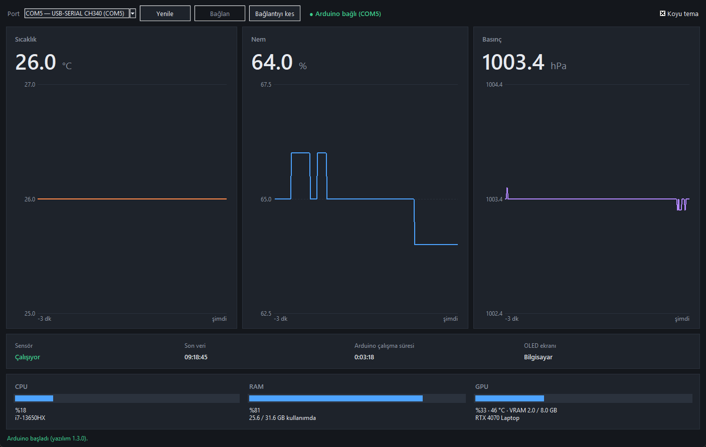
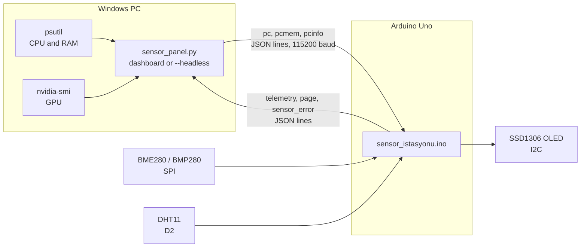

<div align="center">
  
  <h1>Arduino Sensor Station</h1>
  <p><strong>Desk weather station on an Arduino Uno that also shows your PC's CPU, RAM and GPU on a tiny OLED, with a Windows dashboard.</strong></p>

  <p>
    <strong>Language:</strong> <a href="README.md"><strong>EN</strong></a> | <a href="README.tr.md"><strong>TR</strong></a>
    &nbsp;•&nbsp;
    <a href="#wiring">Wiring</a> ·
    <a href="#getting-started">Getting started</a> ·
    <a href="#how-it-works">How it works</a>
  </p>

  <p>
    
    
    
    
    
    
    
  </p>
  <p align="center">
    
    <a href="https://github.com/hfatih/arduino-sensor-istasyonu/stargazers"></a>
    <a href="https://github.com/hfatih/arduino-sensor-istasyonu/forks"></a>
    <a href="https://github.com/hfatih/arduino-sensor-istasyonu/commits"></a>
  </p>
</div>

---

## Overview

**Arduino Sensor Station** is a small desk gadget: an Arduino Uno with a temperature, humidity and pressure sensor and a 0.96" OLED. The screen rotates on its own between your PC's live stats and the room readings. A Python dashboard on the PC shows the same sensor data with charts, and feeds the PC stats to the OLED over USB.

Everything runs locally over a USB serial cable. No network, no cloud, no account.

## Screenshots

| Windows dashboard |
| :---: |
|  |
| *Live sensor cards with 10-minute charts, plus CPU, RAM and GPU of the PC.* |

Captured from real hardware: a BMP280 for temperature and pressure, a DHT11 for humidity, after about three minutes of data.

The OLED is a 16×8 character display. Its two pages look like this:

```text
┌────────────────┐   ┌────────────────┐
│   BILGISAYAR   │   │SENSOR ISTASYONU│
│i7-13650HX      │   │                │
│CPU         17 %│   │  27.1 C        │
│RAM         68 %│   │  (double size) │
│  21.6/31.6 GB  │   │                │
│RTX 4070 Laptop │   │Nem       48.0 %│
│GPU   5 %   48 C│   │Basinc 1002.1hPa│
│VRAM  2.4/8.0 GB│   │Sensor:  OK     │
└────────────────┘   └────────────────┘
   30 seconds            5 seconds
```

## Features

### On the OLED

- **Automatic rotation:** 30 seconds of PC stats, 5 seconds of sensor readings. Both durations are constants at the top of the sketch.
- **PC page:** CPU and GPU model names, CPU %, RAM % and GB, GPU %, GPU temperature, VRAM GB.
- **Sensor page:** temperature in large digits, humidity, pressure, sensor status.
- If the PC stops sending data, the display stays on the sensor page instead of showing stale numbers.
- Character-mode rendering (U8x8): no frame buffer in RAM, only the cells that change are redrawn.

### Sensors

- **BME280 or BMP280 over SPI**, detected by chip ID. Many modules sold as BME280 are BMP280, which cannot measure humidity; the sketch accepts both.
- **Optional DHT11** on D2 supplies humidity when the main sensor is a BMP280. It is read without an external library.
- Readings outside the datasheet range are rejected. A missing or failed sensor shows `--`, never a fake zero, and is retried every 5 seconds.
- Calibration constants for temperature and humidity offset.

### Windows dashboard

- Large cards for temperature, humidity and pressure, each with a 10-minute chart. Invalid samples leave a gap in the chart.
- CPU, RAM and GPU bars with model names. GPU data comes from `nvidia-smi`.
- COM port list, connect and disconnect, automatic reconnect when the cable comes back.
- Dark and light theme.
- Serial reading and GPU queries run on background threads; malformed lines are ignored.

### Headless sender

- `--headless` runs with no window and only feeds the PC stats to the OLED. It finds the board's port on its own and reconnects after a disconnect.
- Measured on a 20-thread laptop CPU: about 0.3 % of total CPU (almost all of it `nvidia-smi`, queried every 5 seconds) and 24 MB of RAM.

## How it works



Both directions use one JSON object per line. The Uno's serial receive buffer is only 64 bytes and the sketch cannot read it for about 150 ms while it redraws the OLED, so every command is kept under 63 characters and the PC leaves at least 330 ms between lines. It also waits for the board's first message before sending, so nothing is lost while the board boots. The full message reference is in [KURULUM.md](KURULUM.md#protokol).

## Wiring

| Module | Pin | Arduino Uno |
| --- | --- | --- |
| OLED | GND / VCC | GND / 5 V |
| OLED | SCL / SDA | A5 / A4 |
| BME280 / BMP280 | GND / VCC | GND / **3.3 V** |
| BME280 / BMP280 | SCL | D13 (SCK) |
| BME280 / BMP280 | SDA | D11 (MOSI) |
| BME280 / BMP280 | SDO | D12 (MISO) |
| BME280 / BMP280 | CSB | D10 (CS) |
| DHT11 (optional) | DATA / + / − | D2 / 5 V / GND |

> [!WARNING]
> BME280 and BMP280 are 3.3 V chips. Power the module from the Uno's 3.3 V pin, not 5 V. The Uno's SPI pins still drive 5 V signals, which is above the chip's rated input level. A direct connection works on the bench but is out of spec; for a permanent build put a logic level shifter on SCK, MOSI and CS.

## Getting started

### Requirements

- Arduino IDE 2.x with the **Arduino AVR Boards** package
- Arduino libraries: **Adafruit BME280 Library**, **Adafruit BMP280 Library**, **U8g2**
- Python 3.10 or newer on Windows

### Flash the board

1. Open `sensor_istasyonu/sensor_istasyonu.ino` in Arduino IDE.
2. Select **Tools → Board → Arduino Uno** and the board's COM port. Clone boards show up as *USB-SERIAL CH340*.
3. Upload.

### Run the dashboard

```powershell
python -m pip install -r requirements.txt
python sensor_panel.py
```

Pick the port and press **Bağlan** (Connect). The dashboard interface is in Turkish.

### Run without a window

```powershell
pythonw sensor_panel.py --headless
```

The dashboard and the headless sender cannot run at the same time; a serial port opens for one program only. Close the Arduino IDE Serial Monitor too.

### Self-test

```powershell
python sensor_panel.py --selftest
```

Checks the parsing and command-building logic. It needs no hardware and no extra packages.

## Configuration

Constants at the top of `sensor_istasyonu.ino`:

| Constant | Default | Meaning |
| --- | --- | --- |
| `PC_PAGE_MS` | `30000` | Time on the PC page |
| `SENSOR_PAGE_MS` | `5000` | Time on the sensor page |
| `TEMP_OFFSET_C` | `0.0` | Added to the temperature reading |
| `DHT_HUM_OFFSET` | `0.0` | Added to the DHT11 humidity reading |
| `OLED_I2C_ADDR` | `0x3C` | Use `0x3D` if your module is set to it |

For a 1.3" SH1106 display, change the display class as described in the comment next to it.

## Tested and not tested

- The sketch compiles for the Uno without warnings: 27,990 bytes of flash (86 %), 936 bytes of RAM (45 %).
- Run on real hardware: a CH340 Uno clone, a BMP280 over SPI, a DHT11, an SSD1306 OLED and a Windows 11 PC with an NVIDIA GPU. 100 seconds of dashboard traffic across six page changes produced no rejected lines.
- The DHT11 reader runs against a real DHT11 on D2.
- Not run against a genuine BME280 (chip ID 0x60); the module on hand turned out to be a BMP280.
- GPU stats need an NVIDIA card. On AMD and Intel GPUs the dashboard says GPU data is unavailable and the OLED shows `--`.
- OLED text is ASCII only; the font has no Turkish letters or degree sign.

## Documentation

[KURULUM.md](KURULUM.md) (Turkish) has the hardware review, the step-by-step test plan, a troubleshooting table and the serial protocol reference.

## License

[MIT](LICENSE)
