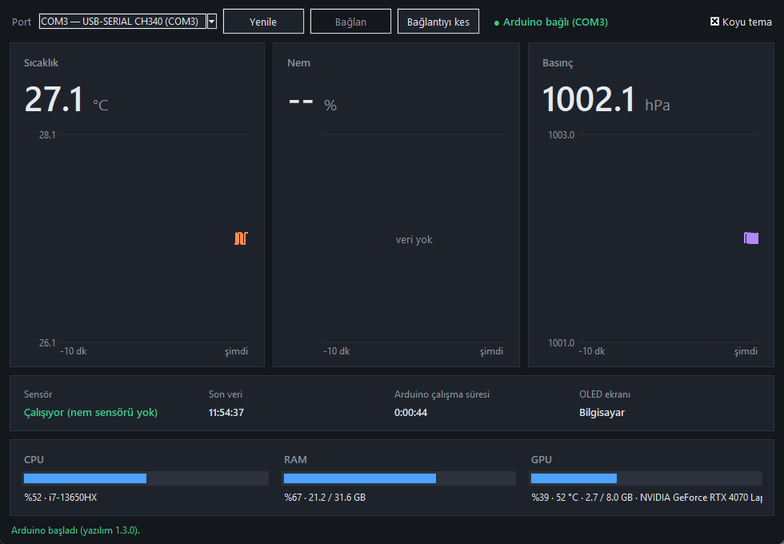

# Arduino Sensör İstasyonu

Arduino Uno ile sıcaklık, nem ve basınç ölçen; küçük OLED ekranında hem bu ölçümleri hem de bilgisayarın CPU, RAM ve GPU durumunu gösteren masaüstü istasyonu. Yanında Windows için bir Python paneli gelir.

*Arduino Uno weather station (BME280/BMP280 + DHT11 + SSD1306 OLED) that also shows the host PC's CPU, RAM and GPU stats on the OLED, with a Tkinter dashboard for Windows. Documentation is in Turkish.*



## Ne yapar

- **OLED kendiliğinden döner:** 30 saniye bilgisayar sayfası, 5 saniye sensör sayfası.
  - Bilgisayar: işlemci ve ekran kartı modeli, CPU %, RAM % ve GB, GPU %, GPU sıcaklığı, VRAM GB.
  - Sensör: sıcaklık, nem, basınç.
- **PC paneli:** büyük kartlar, son 10 dakikanın grafikleri, CPU/RAM/GPU çubukları, koyu ve açık tema.
- **Penceresiz mod:** panel açmadan, arka planda yalnız OLED'i besler.
- USB çekilince panel çökmez, kart geri gelince kendisi bağlanır. Sensör koparsa ekranda sahte sıfır değil `--` görünür.

## Donanım

| Parça | Bağlantı |
|---|---|
| Arduino Uno R3 (klon da olur) | USB |
| BME280 ya da BMP280 | SPI: CS D10, MOSI D11, MISO D12, SCK D13, **VCC 3,3 V** |
| SSD1306 OLED 128×64 | I²C: SDA A4, SCL A5 |
| DHT11 (isteğe bağlı) | DATA D2, 5 V |

"BME280" diye satılan modüllerin bir kısmı BMP280 çıkar; BMP280 nem ölçmez. Kod ikisini de tanır, BMP280'de nemi DHT11'den alır.

**Dikkat:** BME280/BMP280 3,3 V'luk çiplerdir. Uno'nun 5 V sinyallerini doğrudan bağlamak çipin sınırı dışındadır; kalıcı kurulumda lojik seviye dönüştürücü kullan. Ayrıntı [KURULUM.md](KURULUM.md) içinde.

## Kurulum

1. Arduino IDE'de şu kütüphaneleri kur: **Adafruit BME280 Library**, **Adafruit BMP280 Library**, **U8g2**.
2. `sensor_istasyonu/sensor_istasyonu.ino` dosyasını aç, Kart: Arduino Uno, portu seç, yükle.
3. Python bağımlılıklarını kur:

```bash
python -m pip install -r requirements.txt
```

4. Paneli çalıştır:

```bash
python sensor_panel.py
```

Panel açmadan yalnız OLED'i beslemek için:

```bash
pythonw sensor_panel.py --headless
```

Donanım ve paket gerektirmeyen kendi testi:

```bash
python sensor_panel.py --selftest
```

Bağlantı tablosu, test planı, hata ayıklama ve seri protokolün tamamı: [KURULUM.md](KURULUM.md).

## Sınırlar

- GPU bilgisi yalnız NVIDIA kartlarda (`nvidia-smi`) gelir.
- Panel Windows için yazıldı.
- DHT11 okuma kodu gerçek sensörle henüz denenmedi.
- OLED fontunda Türkçe harf yok; ekrandaki yazılar ASCII'dir.

## Lisans

[MIT](LICENSE)
