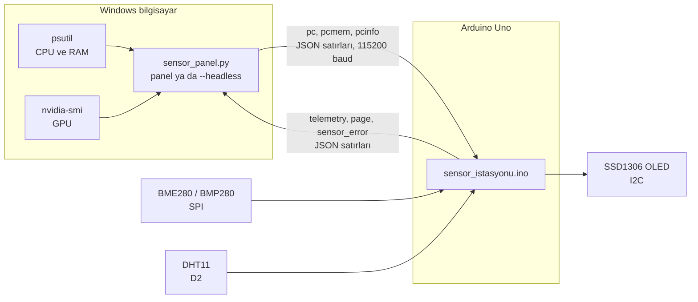

<div align="center">
  
  <h1>Arduino Sensör İstasyonu</h1>
  <p><strong>Arduino Uno üzerinde masaüstü hava istasyonu; küçük OLED ekranda bilgisayarın CPU, RAM ve GPU durumunu da gösterir, yanında Windows paneli gelir.</strong></p>

  <p>
    <strong>Dil:</strong> <a href="README.md"><strong>EN</strong></a> | <a href="README.tr.md"><strong>TR</strong></a>
    &nbsp;•&nbsp;
    <a href="#bağlantılar">Bağlantılar</a> ·
    <a href="#başlarken">Başlarken</a> ·
    <a href="#nasıl-çalışır">Nasıl çalışır</a>
  </p>

  <p>
    
    
    
    
    
    
    
  </p>
</div>

---

## Genel bakış

**Arduino Sensör İstasyonu** küçük bir masa aleti: sıcaklık, nem ve basınç sensörü ile 0,96" OLED takılı bir Arduino Uno. Ekran, bilgisayarın anlık durumu ile oda ölçümleri arasında kendiliğinden döner. Bilgisayardaki Python paneli aynı sensör verisini grafiklerle gösterir ve bilgisayar verisini USB üzerinden OLED'e yollar.

Her şey USB seri kablosu üzerinden yerelde çalışır. Ağ, bulut ya da hesap yok.

## Ekran görüntüleri

| Windows paneli |
| :---: |
|  |
| *10 dakikalık grafikli sensör kartları ve bilgisayarın CPU, RAM, GPU durumu.* |

Gerçek donanımdan, yaklaşık üç dakikalık veriyle alındı: sıcaklık ve basınç BMP280'den, nem DHT11'den.

OLED 16×8 karakterlik bir ekran. İki sayfası şöyle görünür:

```text
┌────────────────┐   ┌────────────────┐
│   BILGISAYAR   │   │SENSOR ISTASYONU│
│i7-13650HX      │   │                │
│CPU         17 %│   │  27.1 C        │
│RAM         68 %│   │  (çift boy)    │
│  21.6/31.6 GB  │   │                │
│RTX 4070 Laptop │   │Nem       48.0 %│
│GPU   5 %   48 C│   │Basinc 1002.1hPa│
│VRAM  2.4/8.0 GB│   │Sensor:  OK     │
└────────────────┘   └────────────────┘
    30 saniye             5 saniye
```

## Özellikler

### OLED'de

- **Kendiliğinden dönüş:** 30 saniye bilgisayar, 5 saniye sensör. İki süre de taslağın başındaki sabitlerdir.
- **Bilgisayar sayfası:** işlemci ve ekran kartı modeli, CPU %, RAM % ve GB, GPU %, GPU sıcaklığı, VRAM GB.
- **Sensör sayfası:** büyük rakamlarla sıcaklık, nem, basınç, sensör durumu.
- Bilgisayar veri yollamayı keserse ekran bayat rakam göstermek yerine sensör sayfasında kalır.
- Karakter kipinde çizim (U8x8): RAM'de kare tamponu yok, yalnız değişen hücreler yeniden yazılır.

### Sensörler

- **SPI üzerinden BME280 ya da BMP280**, çip kimliğinden tanınır. BME280 diye satılan modüllerin bir kısmı BMP280'dir ve nem ölçemez; taslak ikisini de kabul eder.
- **İsteğe bağlı DHT11** (D2), ana sensör BMP280 ise nemi sağlar. Ek kütüphane olmadan okunur.
- Veri sayfası aralığının dışındaki ölçümler reddedilir. Takılı olmayan ya da hata veren sensör sahte sıfır değil `--` gösterir ve 5 saniyede bir yeniden denenir.
- Sıcaklık ve nem ofseti için kalibrasyon sabitleri.

### Windows paneli

- Sıcaklık, nem ve basınç için büyük kartlar, her birinde 10 dakikalık grafik. Geçersiz ölçüm grafikte boşluk bırakır.
- Model adlarıyla CPU, RAM ve GPU çubukları. GPU verisi `nvidia-smi` ile alınır.
- COM port listesi, bağlan ve bağlantıyı kes, kablo geri gelince kendiliğinden yeniden bağlanma.
- Koyu ve açık tema.
- Seri okuma ve GPU sorguları arka plan iş parçacıklarında çalışır; bozuk satırlar yok sayılır.

### Penceresiz gönderici

- `--headless` pencere açmadan çalışır ve yalnız bilgisayar verisini OLED'e yollar. Kartın portunu kendisi bulur, kopunca yeniden bağlanır.
- 20 iş parçacıklı bir laptop işlemcisinde ölçülen yük: toplam CPU'nun yaklaşık %0,3'ü (neredeyse tamamı 5 saniyede bir çalışan `nvidia-smi`) ve 24 MB RAM.

## Nasıl çalışır



İki yönde de her satır tek bir JSON nesnesidir. Uno'nun seri alım tamponu yalnız 64 bayttır ve taslak OLED'i yeniden çizerken yaklaşık 150 ms boyunca onu okuyamaz; bu yüzden her komut 63 karakterin altında tutulur ve bilgisayar satırlar arasında en az 330 ms bekler. Kart açılırken bir şey kaybolmasın diye ilk mesajı gelmeden de göndermeye başlamaz. Mesajların tam listesi [KURULUM.md](KURULUM.md#protokol) içinde.

## Bağlantılar

| Modül | Pin | Arduino Uno |
| --- | --- | --- |
| OLED | GND / VCC | GND / 5 V |
| OLED | SCL / SDA | A5 / A4 |
| BME280 / BMP280 | GND / VCC | GND / **3,3 V** |
| BME280 / BMP280 | SCL | D13 (SCK) |
| BME280 / BMP280 | SDA | D11 (MOSI) |
| BME280 / BMP280 | SDO | D12 (MISO) |
| BME280 / BMP280 | CSB | D10 (CS) |
| DHT11 (isteğe bağlı) | DATA / + / − | D2 / 5 V / GND |

> [!WARNING]
> BME280 ve BMP280 3,3 V'luk çiplerdir. Modülü Uno'nun 5 V pininden değil 3,3 V pininden besle. Uno'nun SPI pinleri yine de 5 V sinyal verir ve bu, çipin izin verilen giriş seviyesinin üstündedir. Doğrudan bağlantı masada çalışır ama sınırın dışındadır; kalıcı kurulumda SCK, MOSI ve CS hatlarına lojik seviye dönüştürücü koy.

## Başlarken

### Gerekenler

- Arduino IDE 2.x ve **Arduino AVR Boards** paketi
- Arduino kütüphaneleri: **Adafruit BME280 Library**, **Adafruit BMP280 Library**, **U8g2**
- Windows'ta Python 3.10 ya da üstü

### Kartı yükle

1. `sensor_istasyonu/sensor_istasyonu.ino` dosyasını Arduino IDE'de aç.
2. **Araçlar → Kart → Arduino Uno** ve kartın COM portunu seç. Klon kartlar *USB-SERIAL CH340* diye görünür.
3. Yükle.

### Paneli çalıştır

```powershell
python -m pip install -r requirements.txt
python sensor_panel.py
```

Portu seç ve **Bağlan**'a bas.

### Penceresiz çalıştır

```powershell
pythonw sensor_panel.py --headless
```

Panel ile penceresiz gönderici aynı anda çalışamaz; seri port tek programa açılır. Arduino IDE'nin Seri Monitörünü de kapat.

### Kendi testi

```powershell
python sensor_panel.py --selftest
```

Ayrıştırma ve komut oluşturma mantığını sınar. Donanım ve ek paket gerektirmez.

## Ayarlar

`sensor_istasyonu.ino` başındaki sabitler:

| Sabit | Varsayılan | Anlamı |
| --- | --- | --- |
| `PC_PAGE_MS` | `30000` | Bilgisayar sayfasının süresi |
| `SENSOR_PAGE_MS` | `5000` | Sensör sayfasının süresi |
| `TEMP_OFFSET_C` | `0.0` | Sıcaklık ölçümüne eklenir |
| `DHT_HUM_OFFSET` | `0.0` | DHT11 nem ölçümüne eklenir |
| `OLED_I2C_ADDR` | `0x3C` | Modülün 0x3D'ye ayarlıysa değiştir |

1,3" SH1106 ekran için ekran sınıfını yanındaki yorumda anlatıldığı gibi değiştir.

## Denenenler ve denenmeyenler

- Taslak Uno için uyarısız derlenir: 27.990 bayt flash (%86), 936 bayt RAM (%45).
- Gerçek donanımda çalıştırıldı: CH340'lı klon Uno, SPI üzerinden BMP280, DHT11, SSD1306 OLED ve NVIDIA ekran kartlı Windows 11 bilgisayar. Altı sayfa değişimi içeren 100 saniyelik panel trafiğinde reddedilen satır olmadı.
- DHT11 okuyucusu D2'deki gerçek bir DHT11 ile çalışıyor.
- Gerçek BME280 (çip kimliği 0x60) ile çalıştırılmadı; eldeki modül BMP280 çıktı.
- GPU verisi için NVIDIA kart gerekir. AMD ve Intel'de panel GPU bilgisinin alınamadığını yazar, OLED `--` gösterir.
- OLED yazıları yalnız ASCII'dir; fontta Türkçe harf ve derece işareti yok.

## Belgeler

[KURULUM.md](KURULUM.md): donanım denetimi, adım adım test planı, hata ayıklama tablosu ve seri protokol.

## Lisans

[MIT](LICENSE)
